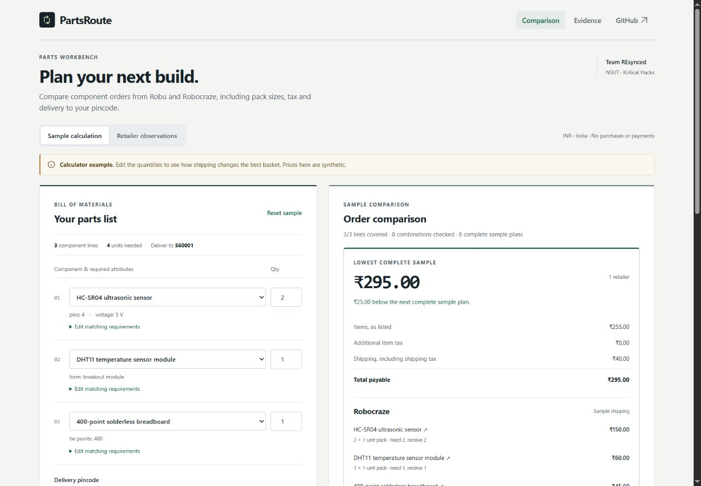

# PartsRoute

**Every part. One complete cost.**

PartsRoute compares the complete cost of an electronics parts list across Indian retailers. Choosing the cheapest listing for each part can cost more once separate shipping charges, packs, minimum orders and taxes are included. Similar titles can also hide incompatible connectors or board versions.

Built by **Team REsynced** for the AI/ML track at **Kritical Hacks**, for student teams, makers and electronics builders.

[Try the sample calculator](https://daksh909-design.github.io/PartsRoute---Every-Part-One-Complete-Cost./) · [Source](https://github.com/Daksh909-design/PartsRoute---Every-Part-One-Complete-Cost./)



## What works today

- Three curated component types, editable quantities, required attributes and one delivery pincode.
- Deterministic basket calculations: pack rounding, minimums, quantity multiples, price breaks, tax treatment and shipping per retailer.
- Specification matching that rejects contradictions; unknown information stays unknown.
- TinyFish Fetch collection and an Agent integration for supported basket interactions, with saved responses and run IDs.
- Background quote jobs, partial results, resumption and a separate evidence view.

**Current limits:** the public site is a synthetic sample calculator. The live application needs a separately running web server, worker and PostgreSQL database. No independent backend has been deployed. Live API checks have returned partial data, but no complete live basket with verified shipping has passed validation. There is no successful end-to-end latency guarantee. See [validation](docs/VALIDATION.md).

The sample calculates ₹255 in items plus ₹40 shipping = **₹295**, using fictional prices. It demonstrates the calculator, not current retailer pricing or a live API call.

## Retailer coverage

| Retailer  | Implementation                              | Known gap                                                                                  |
| --------- | ------------------------------------------- | ------------------------------------------------------------------------------------------ |
| Robu      | Curated product and shipping-policy adapter | Intermittent blocking; checked breadboard unavailable; applicable shipping cost unresolved |
| Robocraze | Curated product and shipping-policy adapter | Complete pincode basket shipping unresolved                                                |

The catalogue contains HC-SR04, DHT11 module and 400-point breadboard requests. Product URLs are curated in [catalogue.ts](src/domain/catalogue.ts). Retailer adapters are provisional until a complete basket is manually verified. Arbitrary-name search, Evelta, Amazon and Flipkart are outside the implemented scope.

## Run locally

Use Node.js 24 and pnpm 11.25.0. Live mode also needs PostgreSQL 17; the Compose file supplies it locally.

```sh
pnpm install --frozen-lockfile
# PowerShell: Copy-Item .env.example .env.local
# macOS/Linux: cp .env.example .env.local
pnpm dev
```

Open http://localhost:3000 for the sample. It works without API credentials.

For live quotes, fill the private environment file, then run:

```sh
docker compose up -d db
pnpm db:migrate
pnpm dev
# In another terminal:
pnpm worker
```

Both processes must use the same database and provider settings. Enter your PartsRoute team token in Live quote and check the connection. Readiness checks configuration, the database and worker; an actual collection is still needed to test provider access. See [live setup](docs/LIVE-SETUP.md) for the complete container option and troubleshooting.

## Configuration

Copy [.env.example](.env.example) without committing the populated file.

| Variable                            | Purpose                                                                         |
| ----------------------------------- | ------------------------------------------------------------------------------- |
| `DATABASE_URL`                      | PostgreSQL connection for web and worker                                        |
| `TINYFISH_API_KEY`                  | Server-side TinyFish Fetch and Agent credential                                 |
| `AI_PROVIDER`                       | `gemini` by default; optional `openai`                                          |
| `GEMINI_API_KEY`, `GEMINI_MODEL`    | Gemini extraction credential and configurable model                             |
| `OPENAI_API_KEY`, `OPENAI_MODEL`    | Only required when explicitly selecting OpenAI                                  |
| `APP_ACCESS_TOKEN`                  | Private team access token of at least 24 characters                             |
| `APP_ORIGIN`, `APP_ALLOWED_ORIGINS` | Exact permitted browser origins                                                 |
| `NEXT_PUBLIC_API_BASE_URL`          | Optional public HTTPS backend origin for a Pages build; never a key             |
| `QUOTE_COLLECTION_BUDGET_MS`        | Shared processing window, default/max 26000 ms; expiry produces partial results |
| `GEMINI_CONCURRENCY`                | Concurrent extraction limit, 1–8; default 8                                     |
| `OBSERVATION_TTL_SECONDS`           | Saved-observation freshness, default 900 seconds                                |
| `MAX_BROWSER_CHECKS`                | Up to three finalist basket checks                                              |

The environment example also documents timeouts and request spacing. Keys stay server-side. There is no automatic provider fallback. See [keys and costs](docs/KEYS-AND-COSTS.md).

## TinyFish and AI

[TinyFish Fetch](https://docs.tinyfish.ai/) retrieves product and policy content through `POST https://api.fetch.tinyfish.ai`. Requests are batched by retailer and per-URL errors are inspected even when the batch returns HTTP 200. Originals, retrieval times, source URLs and provider IDs are stored in PostgreSQL.

TinyFish Agent starts supported guest-basket checks through `POST https://agent.tinyfish.ai/v1/automation/run-async`; the worker saves the run ID and polls `GET /v1/runs/{id}`. It does not log in, pay or place orders. A result must match the exact basket, quantities, pincode and displayed arithmetic before shipping is accepted. Ambiguous submissions are recovered rather than blindly repeated. TinyFish Search is not used because automatic discovery is not implemented.

Gemini is the default extraction provider. An optional adapter uses the official OpenAI SDK and Structured Outputs. Both sit behind `AIProvider`; Zod and source-excerpt checks validate extracted facts. AI reads specifications and explains validated results. Application code calculates prices and ranks plans. Retrieved pages are untrusted data, not instructions.

## How comparison works

Each component line is assigned to one eligible offer. The optimizer enumerates combinations, rounds quantities on the offer's pack basis, applies published constraints and price tiers, adds taxes only when excluded, and consolidates shipping per retailer basket. Money uses integer paise. Unknown tax, stock constraints or shipping cannot become an assumed verified total.

Documented rules shortlist candidates; at most three distinct retailer baskets are selected for browser verification. Only complete verified plans qualify for recommendation: **best verified plan among checked options**. Partial estimates are displayed separately. See [architecture and data model](docs/ARCHITECTURE.md).

## Tests

The code is split by responsibility:

| Directory       | Contents                                                      |
| --------------- | ------------------------------------------------------------- |
| `src/domain`    | Matching, quantity rules, money calculations and plan ranking |
| `src/server`    | TinyFish/AI clients, source validation, queue and persistence |
| `src/app`       | Workspace, results, service connection and evidence views     |
| `db/migrations` | PostgreSQL schema changes                                     |
| `tests`         | Unit and fixture tests                                        |
| `integration`   | Opt-in live provider tests                                    |

Next.js App Router, React and TypeScript provide the web app; Tailwind/CSS handles styling, Zod validates data, and PostgreSQL stores jobs and observations. A separate Node process runs the worker. Dependencies are pinned in the lockfile.

```sh
pnpm test
pnpm check:docs
pnpm typecheck
pnpm build
pnpm build:pages
```

Tests cover packs, minimum quantities, price tiers, consolidated shipping, thresholds, tax inclusion, specification mismatches, stock, unknown shipping, partial failures and manually calculated rankings. Fixtures in `fixtures/` are labelled synthetic.

`pnpm test:postgres` requires a dedicated disposable `TEST_DATABASE_URL`. `pnpm validate:providers` and `pnpm validate:live 560001` call real providers and may consume quota; stop the regular worker before the latter. [Validation](docs/VALIDATION.md) separates executed checks from unresolved work.

## Deployment and demo

GitHub Pages serves static UI only. `pnpm build:pages` creates the export recorded in `artifacts/pages-build.json`. With no backend origin, it offers the sample and live setup instructions. The build does not read private environment files.

Live deployment needs a Node web service, a separate Node worker and persistent PostgreSQL. [Deployment instructions](docs/DEPLOYMENT.md) cover both processes, migrations, health and recovery. The Render blueprint is prepared but untested and uses paid services. The earlier temporary tunnel is a historical development preview, not durable hosting.

[Demo walkthrough](docs/DEMO-GUIDE.md) · [Retailer findings](docs/FEASIBILITY.md) · [Performance](docs/PERFORMANCE.md) · [Evidence index](docs/evidence/README.md)

A presentation link and demo video have not been added.

## Roadmap

- **MVP completion:** manually verify extraction, qualify both retailers, obtain one complete live shipping result and deploy the independent backend.
- **Version 1:** labelled extraction evaluation, broader curated catalogue, stronger account controls and operational monitoring.
- **Version 2:** TinyFish Search discovery and additional retailers after variant, seller and shipping qualification.

## Team

**Team REsynced — NSUT**: [Daksh Sachdev](https://github.com/Daksh909-design) (Team Leader), Niyati Jain, Parth, Tashi Saxena and Ritesh Kumar.
