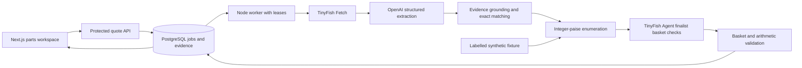

# Architecture

`src/domain` is the pure business layer. Zod schemas define PartRequest, Offer, Evidence, ShippingObservation and QuoteInput; TypeScript types define computed QuoteResult, Plan and Basket. The optimizer takes normalized inputs and never calls an LLM or retailer. Units per pack, minimum quantities and price breaks all use an explicit pack basis. `src/server` owns provider calls, grounding, database state and access checks. Routes are Node-only. The client receives no provider secrets.

## Persistence and recovery

- `quotes`: validated input, status, progress, result snapshot, errors, attempts and worker lease. Create uses a caller request ID and a body/token fingerprint. Refresh requests are deliberate new jobs.
- `observations`: original JSON response, normalized result, URL, retrieval time, collection method and provider ID, uniquely keyed by quote/operation. Cached copies preserve the original timestamp.
- `provider_operations`: one row per exact basket operation. Submission is recorded before Agent creation, then the run ID is persisted immediately. Restarts poll that ID. An uncertain submission never automatically creates another run.
- `provider_usage`: actual OpenAI token usage/request/model and available TinyFish usage/step information. Missing metrics and monetary cost remain unknown.
- `rate_events`: durable private-team create quota. Creation is serialized under a PostgreSQL advisory transaction lock and limited to six per hour and three queued/running jobs.

The worker claims jobs with `FOR UPDATE SKIP LOCKED`, renews a 60-second lease every ten seconds and caps recovery attempts at three. Retailer collectors run concurrently, with sequential requests within each, limiting Fetch/extraction concurrency to two. Browser finalist checks are sequential and limited to three distinct baskets across the three shortlisted plans. If a worker dies after submission but before saving the ID, reconcile with TinyFish dashboard and `recover:run`.

## Trust and correctness boundaries

Retrieved content is untrusted data. The model receives no API tools, database credentials or purchase capability. It must provide schema-constrained fields and exact source excerpts. Grounding checks monetary strings and supported facts; deterministic matching rejects contrary models/attributes. This does not eliminate extraction error: human sample review and a labelled extraction evaluation are still required.

Live shipping policy extraction is stored and displayed, but pincode applicability is never inferred from a nationwide banner. Tests exercise threshold arithmetic using explicit synthetic rules. Actual live ranking requires exact basket verification, matching quantities/pincode/subtotal, serviceability and a displayed arithmetic-consistent complete total.

Missing costs are null, not zero. A verified plan must cover every requested line and every participating retailer basket. Alternative plans may remain unknown or estimated. Ranking does not claim market-wide cheapest purchase.

The supported-domain check accepts only exact HTTPS apex/www domains, rejects embedded credentials/nonstandard ports, validates Fetch final URLs and never accepts client-supplied product URLs. TinyFish may follow redirects before returning; prompts restrict Agent navigation, but this is not a network-level browser sandbox. Add retailer-specific browser/network controls if future provider features allow them.

## Provider extension

Implement `AIProvider` for a future provider; keep extraction schemas, grounding and deterministic math shared. Gemini is intentionally not implemented in this MVP. Automatic discovery would require TinyFish Search and a separate URL/specification review stage.
