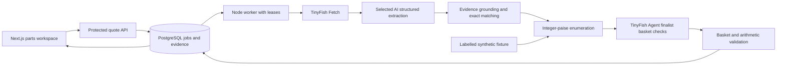

# Architecture

`src/domain` is the pure business layer. Zod schemas define PartRequest, Offer, Evidence, ShippingObservation and QuoteInput; TypeScript types define computed QuoteResult, Plan and Basket. The optimizer takes normalized inputs and never calls an LLM or retailer. Units per pack, minimum quantities and price breaks all use an explicit pack basis. `src/server` owns provider calls, grounding, database state and access checks. Routes are Node-only. The client receives no provider secrets.

## Persistence and recovery

- `quotes`: validated input, status, progress, result snapshot, errors, attempts and worker lease. Create uses a caller request ID and a body/token fingerprint. Refresh requests are deliberate new jobs.
- `observations`: original JSON response, normalized result, URL, retrieval time, collection method and provider ID, uniquely keyed by quote/operation. Cached copies preserve the original timestamp.
- `provider_operations`: one row per exact basket operation. Submission is recorded before Agent creation, then the run ID is persisted immediately. Restarts poll that ID. An uncertain submission never automatically creates another run.
- `provider_usage`: actual selected AI token usage/request/model and available TinyFish usage/step information. Missing metrics and monetary cost remain unknown.
- `rate_events`: durable private-team create quota. Creation is serialized under a PostgreSQL advisory transaction lock and limited to six per hour and three queued/running jobs.
- `worker_heartbeats`: process presence refreshed every ten seconds. Authenticated readiness requires a heartbeat newer than 45 seconds and accessible migrated tables; configured keys alone do not mark the server ready.

The worker claims jobs with `FOR UPDATE SKIP LOCKED`, renews a 60-second lease every ten seconds and caps recovery attempts at three. Two retailer Fetch batches run concurrently. Independent product extractions start together, bounded to four Gemini requests per quote (configurable from one to four). Browser finalist checks remain limited to three distinct baskets and now share a 45-second polling window. Pending runs remain recoverable; the window does not cancel remote runs or guarantee full quote completion. If a worker dies after submission but before saving the ID, reconcile with TinyFish dashboard and `recover:run`.

## Trust and correctness boundaries

Retrieved content is untrusted data. The model receives no API tools, database credentials or purchase capability. It must provide schema-constrained fields and exact source excerpts. Grounding checks monetary strings and supported facts; deterministic matching rejects contrary models/attributes. This does not eliminate extraction error: human sample review and a labelled extraction evaluation are still required.

Live shipping policy extraction is stored and displayed, but pincode applicability is never inferred from a nationwide banner. Tests exercise threshold arithmetic using explicit synthetic rules. Actual live ranking requires exact basket verification, matching quantities/pincode/subtotal, serviceability and a displayed arithmetic-consistent complete total. If only ordering minima/multiples are missing, a separate provisional candidate can select an Agent inspection. Those proposed defaults never enter public results or saved offers. Only exact-SKU/product controls with min/step source evidence can establish missing constraints; conflicts remain ineligible and offset steps such as min=3/step=2 stay unsupported. The same maximum of three browser checks covers those inspections and shipping.

Missing costs are null, not zero. A verified plan must cover every requested line and every participating retailer basket. Alternative plans may remain unknown or estimated. Ranking does not claim market-wide cheapest purchase.

The supported-domain check accepts only exact HTTPS apex/www domains, rejects embedded credentials/nonstandard ports, validates Fetch final URLs and never accepts client-supplied product URLs. TinyFish may follow redirects before returning; prompts restrict Agent navigation, but this is not a network-level browser sandbox. Add retailer-specific browser/network controls if future provider features allow them.

## Provider extension

Gemini is the default AI provider; OpenAI remains an explicit optional adapter. Gemini calls use a bounded task pool with configurable start spacing, schema-constrained JSON, Zod validation and recorded actual usage. A quota error does not trigger a paid provider. Controlled failure metadata records unknown token usage and a key/model fingerprint, never the key. Readiness blocks repeat creation for five minutes after an account-access failure for the same configuration; transient outages are recorded separately. Provider-supplied error bodies are not sent directly to the UI. Explicitly rejected Agent submissions are distinguished from ambiguous network submissions. `AIProvider` keeps extraction and explanation independent of the calculator. Automatic discovery would require TinyFish Search and a separate URL/specification review stage.

## Frontend and deployment boundary

The UI separates the workspace controller, quote results, evidence view and API client. Reset and mode changes invalidate pending poll responses. Team tokens stay in component memory; a quote ID may be stored locally for resumption. The Pages export includes only public UI/domain files and synthetic fixtures. An optional HTTPS API origin is embedded at build time. The server's API proxy handles approved-origin CORS preflight and rejects unrelated origins; bearer authorization still protects live requests.

## Fast comparisons and background refresh

`POST /api/quotes` always sets refresh=true and enqueues or recovers a fresh job, even when a client omits that flag. It never returns a cached result. It is the primary live UI action. Idempotency and resumption preserve already completed work within that same job to avoid duplicate charges. New jobs bypass the observation and extraction caches, and TinyFish Fetch receives ttl=0. `POST /api/comparisons` is a separate, explicit read-only saved-data action; it never starts a worker or provider call. Cache misses and expiry are visible. `GET /api/quotes/:id` delivers incremental results and job status. `POST /api/observations` retrieves protected original evidence for cached results. No provider keys reach these browser calls.

Fetch requests are batched per retailer. `extraction_cache` stores successful schema-validated extraction by a content/provider/model/prompt hash; only non-refresh internal consumers reuse it. Fresh jobs still trim page furniture before making new model calls. `normalization_version` prevents obsolete grounded offers from entering the saved comparison. `normalized_at` resolves copies with identical source timestamps. Worker pickup checks run every 250 ms, with browser polling at 250 ms plus network time. Provider outages cannot turn unknown data into an eligible offer. The UI measures the full fresh request and marks a missed seven-second target. See [performance](PERFORMANCE.md) for the measured scope and external latency limitations.
